<p align="center">
  
</p>

<p align="center">
  
  
  
  
  
</p>

<h3 align="center">A complete, practical guide to Sigma Computing, written from running it end to end for 50+ restaurant clients.</h3>

> **About this repo.** I was the **Sigma Computing admin with 100% platform ownership** at a restaurant-tech company, building **400+ dashboards for 50+ clients**. This repo explains every Sigma feature I used (what it is, why it matters, how I used it), so anyone who reads it gets a solid understanding of Sigma. Company and client names are left out; all numbers and screens are **synthetic, Sigma-style illustrations**, and each section links to the official Sigma documentation.

---

## 📌 Contents

| | Section | | Section |
|---|---|---|---|
| 1 | [What I worked on](#-1-what-i-worked-on) | 9 | [User attributes & row-level security](#-9-user-attributes--row-level-security) |
| 2 | [What Sigma is (and why it's different)](#-2-what-sigma-is-and-why-its-different) | 10 | [Workbooks & dashboards](#-10-workbooks--dashboards) |
| 3 | [Connecting databases: MySQL & Snowflake](#-3-connecting-databases-mysql--snowflake) | 11 | [Alerts & scheduled exports](#-11-alerts--scheduled-exports) |
| 4 | [Data models: the semantic layer](#-4-data-models-the-semantic-layer) | 12 | [Administration & governance](#-12-administration--governance) |
| 5 | [Relationships](#-5-relationships) | 13 | [Performance & cost](#-13-performance--cost) |
| 6 | [Joins, lookups & unions](#-6-joins-lookups--unions) | 14 | [My delivery playbook](#-14-my-delivery-playbook-400-dashboards-50-clients) |
| 7 | [Custom SQL & optimisation](#-7-custom-sql--optimisation) | 15 | [Real-life use cases](#-15-real-life-use-cases) |
| 8 | [Controls](#-8-controls) | 16 | [Glossary · sources · author](#-16-glossary) |

---

## 🧑‍💻 1. What I worked on

| | |
|---|---|
| 👑 **Role** | Sigma **Admin**, **100% platform ownership**: connections, data models, security, workbooks, users, alerts |
| 📊 **Scale** | **400+ dashboards** for **50+ restaurant clients** (brands with multiple branches) |
| 🔌 **Connections** | **MySQL** (POS) and **Snowflake**, queried live |
| 📐 **Data models** | Governed models with **relationships**, **metrics**, **custom SQL** elements and **RLS** reused by every dashboard |
| 🔐 **Security** | **User attributes** (`restaurant`, `branch`) used in **custom SQL** and formulas for **row-level security** |
| 🧮 **Custom reports** | **Optimised SQL** for complex client reports: multi-grain KPIs, item vs modifier splits, period comparisons |
| 🎛️ **Interactivity** | **Controls** (date range, list values, segmented, top N) wired to elements and to SQL |
| 🔗 **Combining data** | **Joins**, **lookups** and **unions** in data models and workbooks |
| 🔔 **Alerts** | Conditional alerts when clients **hit target revenue** or when a **discrepancy** appears |
| 👥 **Administration** | Teams, workspaces, folders, permissions, account types, onboarding and offboarding |

<p align="center">
  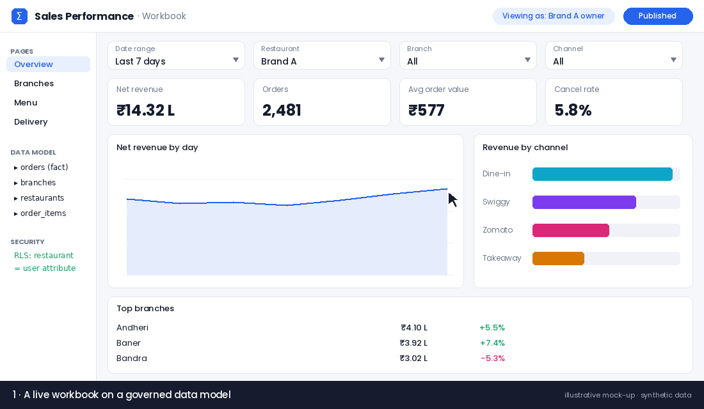
</p>
<p align="center"><sub>Illustrative mock-up on synthetic data: controls re-query live data, RLS changes what each user sees, and an alert fires on a target.</sub></p>

---

## 🧠 2. What Sigma is (and why it's different)

**Sigma Computing** is a cloud-native BI and analytics platform with a **spreadsheet-like interface** on top of your **cloud data warehouse**. Business users work with familiar rows, columns and formulas, while Sigma writes and runs the SQL for them.

<p align="center">
  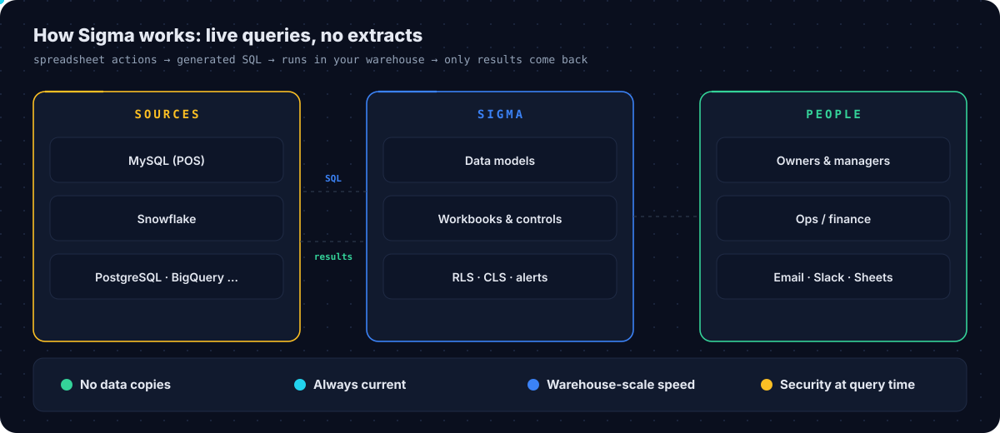
</p>

| Idea | What it means in practice |
|---|---|
| **Live query, no extracts** | Sigma doesn't copy your data into its own store. Every filter, group-by, pivot or formula is **compiled into SQL** in your warehouse's dialect and runs there. |
| **Always current** | Data models pull from the **live source**, so dashboards show what's in the database now, not a stale extract from last night. |
| **Warehouse-scale** | Heavy lifting happens in the warehouse, so the browser only receives results. |
| **Smart reuse** | Results already loaded are reused first, then cached results, then warehouse compute only if needed. Repeated heavy logic can be **materialized**. |
| **Security at query time** | Row- and column-level rules are applied in the generated SQL, per user. |
| **Transparent** | **Query history** shows the SQL each element generated, with timings, which is great for tuning. |

**Why this mattered for us:** restaurant owners check sales many times a day. Live queries meant **no refresh lag** and **no duplicate data pipelines** just for BI.

📖 [Sigma architecture](https://www.sigmacomputing.com/product/architecture)

---

## 🔌 3. Connecting databases: MySQL & Snowflake

Sigma connects to **Snowflake, BigQuery, Redshift, Databricks, PostgreSQL, AlloyDB, MySQL, Azure SQL Database, Starburst and SQL Server**. We used **MySQL** (the POS database) and **Snowflake** (the analytics warehouse).

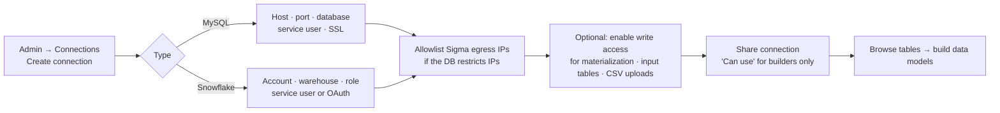

| Setting | Why it matters |
|---|---|
| **Who can create** | Admin account type or the *Manage connections* permission |
| **Service user vs OAuth** | A service user is simple and stable; OAuth runs queries as each user so warehouse RLS policies also apply |
| **Write access** | Needed for **materialization**, **input tables**, **CSV uploads** and **warehouse views** |
| **IP allowlisting** | Add Sigma's egress IPs when the database restricts by IP |
| **Query timeout** | Default 120 s; adjustable under connection features |
| **One connection per query** | Data can't be combined **across** connections, so keep related tables on the same connection |

**How I set it up:** read-only service users per environment, SSL on, only builders get *Can use* on the connection, and viewers only ever touch **data models**, never raw tables.

📖 [Connect to data sources](https://help.sigmacomputing.com/docs/connect-to-data-sources)

---

## 📐 4. Data models: the semantic layer

A **data model** is a Sigma document that acts as a **semantic layer**: you curate tables once, define relationships and metrics, apply security, and publish **reusable data source elements** that workbooks build on. *(Data models replace the older "datasets".)*

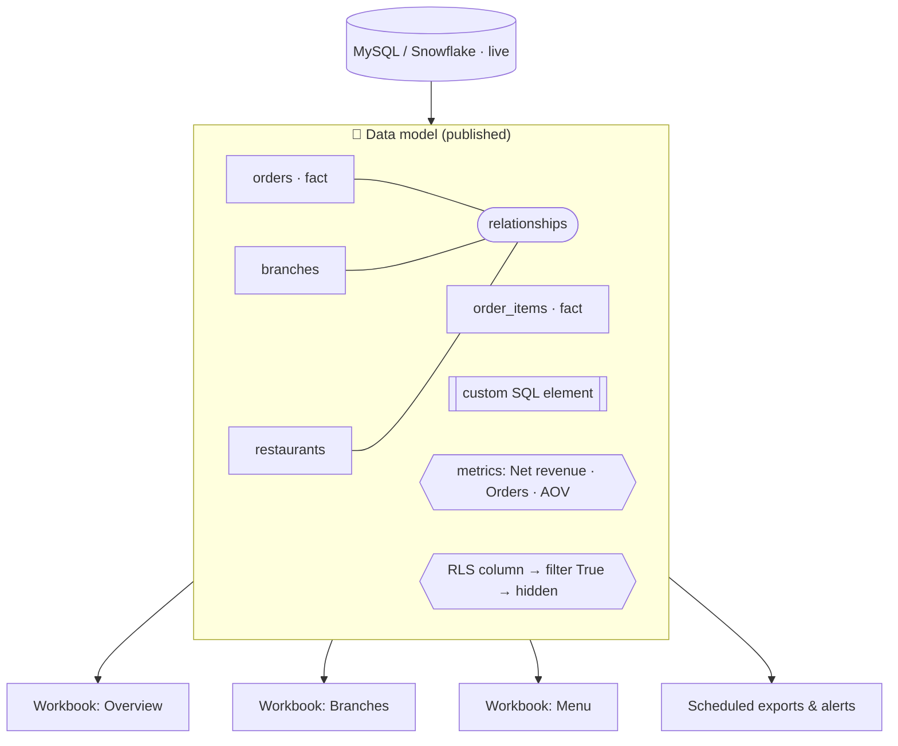

| Component | What it does | How I used it |
|---|---|---|
| **Data source elements** | curated tables / SQL results exposed for reuse | one element per grain: bills, bill lines, payments |
| **Relationships** | stored join logic between elements | orders → branches → restaurants, lines → orders |
| **Metrics** | reusable aggregations defined once | Net revenue, Orders, AOV, Discount %, Cancel rate |
| **Custom SQL elements** | SQL as a model element | complex multi-grain logic, user-attribute filters |
| **Row-level security** | per-user row filtering | `restaurant` user attribute |
| **Column-level security** | hide sensitive columns | cost and margin columns for non-owners |
| **Materialization** | store heavy results in the warehouse | big historical aggregates |
| **Parameters / URL parameters** | let users refine data, pre-set controls from links | branch-specific links |
| **Version tagging** | stable tagged versions | tag before major changes |

**Why data models matter:** define *Net revenue* once and **400+ dashboards** use the same number. Change it once, and every dashboard updates. Permissions are also granted at the model level.

📖 [Get started with data modeling](https://help.sigmacomputing.com/docs/get-started-with-data-modeling) · [Metrics](https://help.sigmacomputing.com/docs/about-metrics)

---

## 🔗 5. Relationships

<p align="center">
  
</p>

A **relationship** stores how two elements connect (key columns, direction, cardinality) **without joining them up front**. When a workbook user adds a related column (e.g. `branch_name` while working on `orders`), Sigma joins **only then**.

| Rule | Detail |
|---|---|
| **Cardinality** | **many-to-one** or **one-to-one** only; the source is the more granular table (fact), the target the less granular one (dimension) |
| **Defined in** | the data model's ERD view (Modeling tab); pick target, map key column(s), name it |
| **Not automatic** | Sigma doesn't infer relationships from database keys; you define them |
| **Same model, same connection** | related elements must live in the same data model and connection |
| **Publish first** | downstream users see related columns after the model is published |

**Why I preferred relationships over pre-joined tables:** joins run **only when needed**, so most queries stay small, and the star schema stays clean. Keeping each source row matched to at most one target row prevents **fan-out** (double-counted revenue).

📖 [Define relationships in data models](https://help.sigmacomputing.com/docs/define-relationships-in-data-models)

---

## 🧩 6. Joins, lookups & unions

<p align="center">
  
</p>

| | **Join** | **Lookup** | **Union** |
|---|---|---|---|
| Adds | columns (new table) | a few columns to the **existing** table | **rows** |
| Types | inner · left outer · right outer · full outer | behaves like a left join | `UNION ALL` (duplicates kept) |
| Row count | can change | **preserved** | sum of sources |
| Best for | big reshapes, non-left logic | 1–2 extra columns | same-shaped data: months, channels, sources |
| Watch out | fan-out on one-to-many keys | slower on very large tables | columns must match name/type; same connection |

**Examples from my work:**
- **Join**: bills ⨝ payments for tender reports (left outer, so unpaid bills stay visible)
- **Lookup**: add `branch_name` and `city` to an item table without changing its rows
- **Union**: aggregator orders + in-store orders into one sales table (see [`05_union_channels.sql`](examples/sql/05_union_channels.sql))

📖 [Joins overview](https://help.sigmacomputing.com/docs/joins-overview) · [Create and edit unions](https://help.sigmacomputing.com/docs/create-and-edit-unions)

---

## 🧮 7. Custom SQL & optimisation

Custom SQL lets you write SQL directly as a **workbook element** or a **data model element** when the visual builder isn't enough.

| Syntax | Use |
|---|---|
| `SELECT … FROM db.schema.table` | query the connection directly |
| `sigma_element('Element title')` | query another element in the workbook |
| `{{control-id}}` | read a **control** value |
| `{{#formula CurrentUserAttributeText('restaurant')}}` | read the running user's **user attribute** |
| `{{system::CurrentUserAttributeText::restaurant}}` | alternative user-attribute syntax |
| `{{#formula CurrentUserEmail()}}` | read the running user's email |

**Limits to know:** SQL runs as a **subquery** (no DDL/DML or multiple statements); sort order from SQL isn't guaranteed (sort in the UI); custom SQL that references a column bypasses its **column-level security**; elements using `sigma_element()` can't be materialized.

### How I optimised complex client reports

| Technique | Why | Example |
|---|---|---|
| **Filter first** | less data scanned | status + date range in the first CTE |
| **Aggregate each grain separately** | no fan-out between bills and lines | `bill_kpis` and `item_kpis` CTEs joined at the end |
| **Join aggregates, not raw rows** | tiny joins | branch × channel summaries |
| **Controls inside SQL** | the warehouse filters, not the browser | `{{start-date}}`, `{{end-date}}` |
| **`NULLIF` on divisors** | no divide-by-zero | AOV, discount % |
| **Relationships for dimensions** | joins only when used | branch, restaurant names |
| **Materialize heavy history** | reuse expensive results | 12-month aggregates |
| **Query history review** | find slow elements | before every release |

```sql
WITH bills AS (            -- filter as early as possible
    SELECT order_id, branch_id, channel, net_amount, discount
    FROM orders
    WHERE status = 'completed'
      AND order_ts >= {{start-date}} AND order_ts < {{end-date}}
),
bill_kpis AS (             -- one row per branch × channel
    SELECT branch_id, channel, COUNT(*) AS orders, SUM(net_amount) AS net_revenue
    FROM bills GROUP BY branch_id, channel
)
SELECT br.branch_name, k.channel, k.orders, k.net_revenue,
       ROUND(k.net_revenue / NULLIF(k.orders, 0), 2) AS avg_order_value
FROM bill_kpis k
JOIN branches br ON br.branch_id = k.branch_id
```

📂 Full examples: [`examples/sql/`](examples/sql) · 📖 [Write custom SQL](https://help.sigmacomputing.com/docs/write-custom-sql)

---

## 🎛️ 8. Controls

<p align="center">
  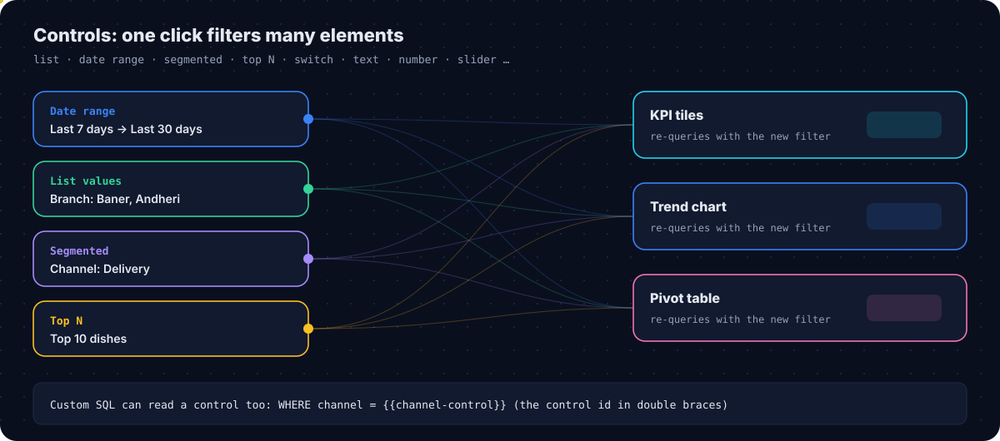
</p>

**Controls** are interactive inputs on a workbook page. Each control **targets** one or more elements; changing it re-queries those elements live.

| Control | Input | Typical use |
|---|---|---|
| **List values** | pick from a list (multi-select) | branches, channels, categories |
| **Date** / **Date range** | calendar, fixed or relative | "Last 30 days", custom ranges |
| **Segmented** | one-click segments | Dine-in · Takeaway · Delivery |
| **Top N** | rank direction + N | top 10 dishes |
| **Text input** / **Text area** | free text | search a product |
| **Number input** / **Number range** | numbers with operators | bill size ranges |
| **Slider** / **Range slider** | drag | discount %, dates |
| **Switch** / **Checkbox** | on/off | "include cancelled" |
| **Drill down**, **Legend**, **Hierarchy** | navigation-style inputs | drill paths, chart legends |

| Concept | Detail |
|---|---|
| **Control ID** | used in formulas, custom SQL (`{{control-id}}`), URLs and the API; renaming the label is safe, changing the ID can break references |
| **Synced controls** | same control on several pages shares one ID and settings |
| **URL parameters** | pre-set control values in a link (e.g. a branch-specific dashboard link) |
| **Security rule** | **never** use a control to enforce RLS; users can change controls. Filter the data-model element directly. |

📖 [Intro to control elements](https://help.sigmacomputing.com/docs/intro-to-control-elements)

---

## 🔐 9. User attributes & row-level security

<p align="center">
  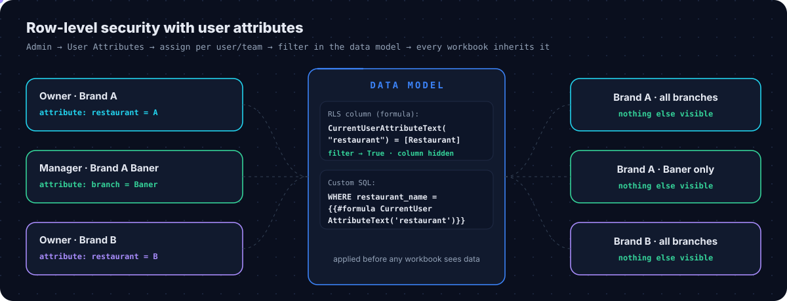
</p>

**User attributes** are named values attached to users or teams (e.g. `restaurant = Brand A`). Sigma injects the **running user's** value into formulas and SQL, which makes them ideal for **row-level security (RLS)**.

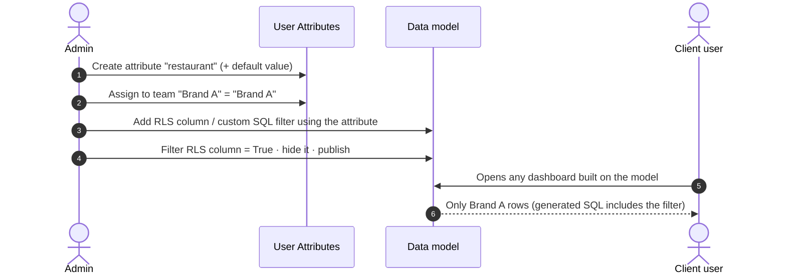

**Setup, step by step**
1. **Administration → User Attributes → Create Attribute**: name (`restaurant`), optional description and **default value**.
2. **Assign Attribute** to **teams** (preferred) or individual users. Team order sets precedence; a **user-level value overrides** team values.
3. In the **data model**, add an RLS column:
   ```text
   CurrentUserAttributeText("restaurant") = [Restaurant Name]
   ```
   or filter **custom SQL**:
   ```sql
   WHERE restaurant_name = {{#formula CurrentUserAttributeText('restaurant')}}
   ```
4. **Filter the RLS column to True**, **hide** it, **publish**. Every downstream workbook inherits it.

| Other RLS patterns | Formula |
|---|---|
| By team | `CurrentUserInTeam([Team Name])` |
| By email | `[Manager Email] = CurrentUserEmail()` |
| Managers see all | `([Manager Email] = CurrentUserEmail()) or CurrentUserInTeam("Head Office")` |

**Best practices I followed:** prefer user attributes over hard-coded emails, apply RLS **in the data model** (protects every workbook), never via controls, match data types, hide helper columns, and add **column-level security** for sensitive columns such as cost.

📖 [Set up row-level security](https://help.sigmacomputing.com/docs/set-up-row-level-security) · [Configure user attributes](https://help.sigmacomputing.com/docs/user-attributes)

---

## 📊 10. Workbooks & dashboards

A **workbook** is where analysis and dashboards live. It has **pages**, and each page holds **elements**.

| Element group | Elements |
|---|---|
| **Data** | tables, pivot tables, charts (KPIs, bar, line, area, combo, maps…) |
| **Input** | input tables (empty or linked) for targets, notes, manual adjustments |
| **Controls** | filters and inputs (section 8) |
| **UI** | text, images, buttons, embeds, dividers |
| **Layout** | containers, tabbed containers, modals |

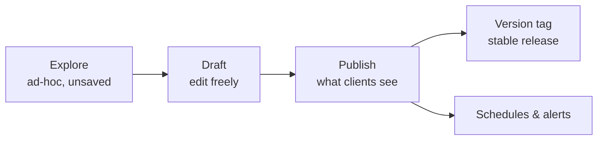

**My dashboard system for 50+ clients**
- **Template pages**: Overview, Branches, Channels, Menu (items vs modifiers), Payments, Delivery
- **Consistent controls** at the top of every page (date range, restaurant, branch, channel), **synced** across pages
- **KPI row first**, trend second, breakdowns third, detail table last
- **Input table for targets** so clients see progress vs plan, and alerts can fire on it
- Built once on the template model, then duplicated per client: that's how **400+ dashboards** stayed maintainable

📖 [Workbooks overview](https://help.sigmacomputing.com/docs/workbooks-overview)

---

## 🔔 11. Alerts & scheduled exports

<p align="center">
  
</p>

**Scheduled exports** send a workbook, page or element on a schedule. **Conditional exports / alerts** send **only when a condition is true**.

| Condition type | Example |
|---|---|
| **If there's data** / **If there's no data** | discrepancy query returns rows → alert |
| **If a condition is met: Any value / All values** | any branch where `target_achieved = True` |
| **KPI value / comparison %** (KPI elements) | revenue KPI ≥ ₹10 L, or comparison < −15% |

| Destinations | Formats |
|---|---|
| Email (incl. email bursts) · Slack · Microsoft Teams · SharePoint · Google Sheets · Google Drive · Webhook · Cloud storage | workbook: Excel, PDF · page: Excel, PDF, PNG · element: CSV, Excel, JSON, PDF, PNG |

**Alerts I built for clients**
- 🎯 **Target achieved**: month-to-date revenue ≥ the branch target ([`03_target_achievement_alert.sql`](examples/sql/03_target_achievement_alert.sql))
- ⚠️ **Discrepancy**: POS orders don't match the reporting model ([`04_discrepancy_check.sql`](examples/sql/04_discrepancy_check.sql))
- 📉 **Drop**: delivery orders down sharply vs the same weekday last week
- 📬 **Daily summary**: yesterday's KPIs to owners every morning

📖 [Schedule a conditional export or alert](https://help.sigmacomputing.com/docs/schedule-a-conditional-export-or-alert) · [Send or schedule workbook exports](https://help.sigmacomputing.com/docs/send-or-schedule-workbook-exports)

---

## 👥 12. Administration & governance

| Area | What I managed |
|---|---|
| **Users & account types** | invited users with the right account type (viewers vs builders vs admins) |
| **Teams** | one team per client brand + internal teams; public/private visibility |
| **Workspaces** | one per client, linked to its team; folders for dashboards, models, drafts, archive |
| **Permissions** | Can view · Can explore · Can edit (documents); Can contribute · Can manage (workspaces) |
| **Connections** | who can *use* each connection |
| **User attributes** | `restaurant`, `branch`, `role` for RLS |
| **Lifecycle** | onboarding checklist, offboarding by removing team membership |

| Permission | Can do |
|---|---|
| **Can view** | view, copy, send/schedule exports, use data models as sources |
| **Can explore** | view + ad-hoc analysis in workbooks |
| **Can edit** | explore + edit, publish, share, move, delete |
| **Can contribute** *(workspace)* | create/manage own documents, view and explore others |
| **Can manage** *(workspace)* | full control including access management |

📂 Full checklist: [`docs/admin-playbook.md`](docs/admin-playbook.md) · 📖 [Folder & document permissions](https://help.sigmacomputing.com/docs/folder-and-document-permissions) · [Manage teams](https://help.sigmacomputing.com/docs/manage-teams)

---

## ⚡ 13. Performance & cost

| Lever | Effect |
|---|---|
| **Relationships instead of pre-joins** | joins only run when related columns are used |
| **Metrics in the data model** | one optimised definition instead of many ad-hoc formulas |
| **Filter early (SQL + controls)** | less data scanned per query |
| **Materialization** | heavy, popular results stored as warehouse tables; schedule right after source refresh. RLS elements can't be materialized, so materialize upstream aggregates and apply RLS after. |
| **Query history** | see the generated SQL and timing per element |
| **Fewer, focused elements per page** | fewer parallel queries |

📖 [Materialization](https://help.sigmacomputing.com/docs/materialization)

---

## 🔁 14. My delivery playbook (400+ dashboards, 50+ clients)

<p align="center">
  
</p>

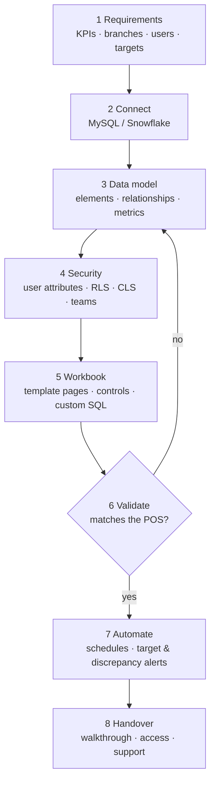

**Why it scaled:** everything client-specific lives in **user attributes, team access and the data model's filters**. The dashboards themselves are shared templates, so improving one template improves it for every client.

---

## 🌍 15. Real-life use cases

| Who | Question | Sigma feature |
|---|---|---|
| 👨‍🍳 Restaurant owner | "How are all my branches doing this month vs target?" | KPI row + input-table targets + target alert |
| 🏪 Branch manager | "Only my branch, last 7 days" | RLS by `branch` attribute + date range control |
| 🛵 Ops lead | "Which channel is dropping?" | segmented control + comparison KPIs + drop alert |
| 📋 Menu team | "Items sold as item vs as modifier, by category" | custom SQL element + pivot table |
| 💰 Finance | "Discounts and tender split, exported every Monday" | joins (bills ⨝ payments) + scheduled Excel export |
| 🧾 Data team | "Do reports match the POS?" | discrepancy query + "If there's data" alert |

---

## 📖 16. Glossary

| Term | Meaning |
|---|---|
| **Workbook** | document with pages of elements; explore → draft → publish |
| **Element** | a table, pivot, chart, control, input table, text, etc. on a page |
| **Data model** | governed semantic layer of reusable data source elements |
| **Relationship** | stored many-to-one join logic, executed only when used |
| **Metric** | reusable aggregation defined on a data source |
| **Custom SQL element** | SQL written directly as an element |
| **Control** | interactive input that filters target elements |
| **User attribute** | per-user/team value used in formulas and SQL |
| **RLS / CLS** | row- / column-level security |
| **Materialization** | storing an element's results as a warehouse table |
| **Conditional export / alert** | scheduled send that happens only if a condition is true |
| **Input table** | editable table inside a workbook, written back to the warehouse |
| **Version tag** | a named, stable version of a workbook or data model |

## 🗂️ Repository structure

```text
sigma-computing-analytics-platform/
├── README.md                       # this masterclass
├── assets/                         # animated diagrams + workbook GIF (synthetic)
├── examples/sql/
│   ├── 01_rls_by_user_attribute.sql
│   ├── 02_optimized_branch_report.sql
│   ├── 03_target_achievement_alert.sql
│   ├── 04_discrepancy_check.sql
│   └── 05_union_channels.sql
└── docs/
    ├── admin-playbook.md           # teams · workspaces · permissions · onboarding
    └── sigma-formulas.md           # formulas I used most
```

## 📚 Sources

Official Sigma documentation used for this guide:
[Architecture](https://www.sigmacomputing.com/product/architecture) ·
[Connect to data sources](https://help.sigmacomputing.com/docs/connect-to-data-sources) ·
[Data modeling](https://help.sigmacomputing.com/docs/get-started-with-data-modeling) ·
[Relationships](https://help.sigmacomputing.com/docs/define-relationships-in-data-models) ·
[Metrics](https://help.sigmacomputing.com/docs/about-metrics) ·
[Joins](https://help.sigmacomputing.com/docs/joins-overview) ·
[Unions](https://help.sigmacomputing.com/docs/create-and-edit-unions) ·
[Custom SQL](https://help.sigmacomputing.com/docs/write-custom-sql) ·
[Controls](https://help.sigmacomputing.com/docs/intro-to-control-elements) ·
[Row-level security](https://help.sigmacomputing.com/docs/set-up-row-level-security) ·
[User attributes](https://help.sigmacomputing.com/docs/user-attributes) ·
[Workbooks](https://help.sigmacomputing.com/docs/workbooks-overview) ·
[Conditional alerts](https://help.sigmacomputing.com/docs/schedule-a-conditional-export-or-alert) ·
[Exports](https://help.sigmacomputing.com/docs/send-or-schedule-workbook-exports) ·
[Materialization](https://help.sigmacomputing.com/docs/materialization) ·
[Permissions](https://help.sigmacomputing.com/docs/folder-and-document-permissions) ·
[Teams](https://help.sigmacomputing.com/docs/manage-teams)

<sub>Sigma Computing is a trademark of its owner. This is an independent, educational write-up; visuals are original illustrations on synthetic data, not Sigma product screenshots.</sub>

## 🔗 Related

- [Rill Client Analytics Platform](https://github.com/suyogpatil395/rill-client-analytics-platform): where the client reporting moved next
- [Analytics Studio](https://github.com/suyogpatil395/analytics-studio): AI report builder on a semantic layer

---

## 👤 Author

<div align="center">

**Suyog Patil**
*Data Engineer · Sigma Computing Admin · Analytics & BI*

[](https://www.linkedin.com/in/suyog-patil-0089241b2/)
[](https://github.com/suyogpatil395)

⭐ If this helped you learn Sigma, consider starring the repo.

</div>
